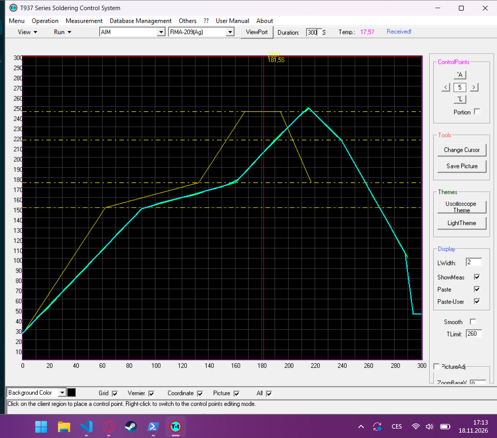
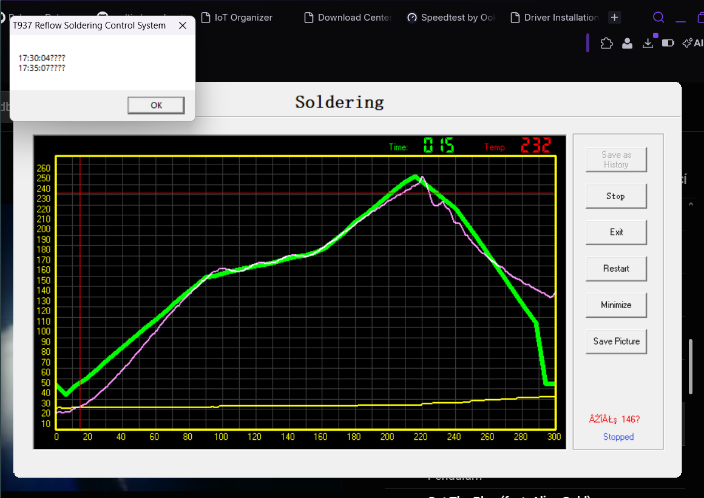
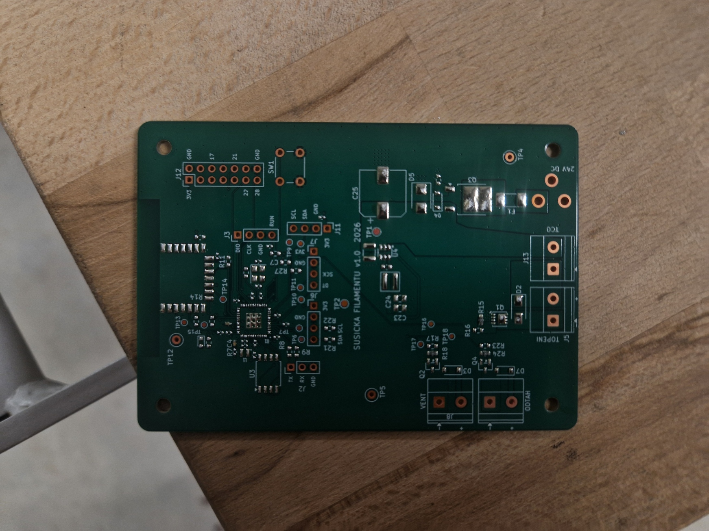
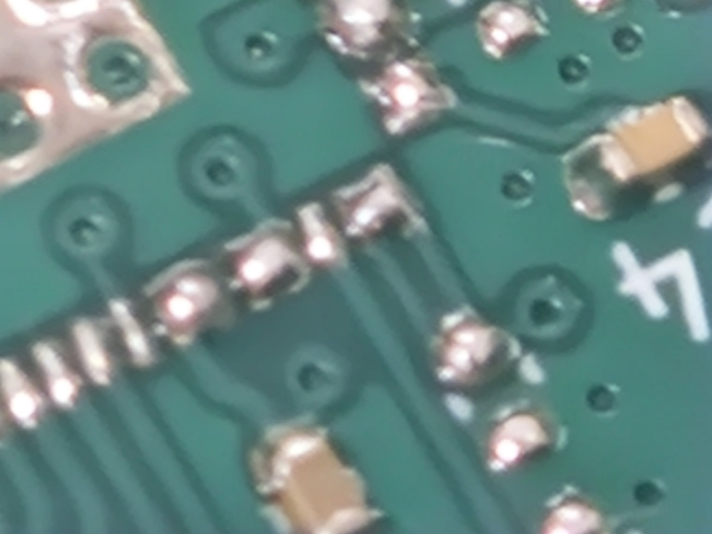
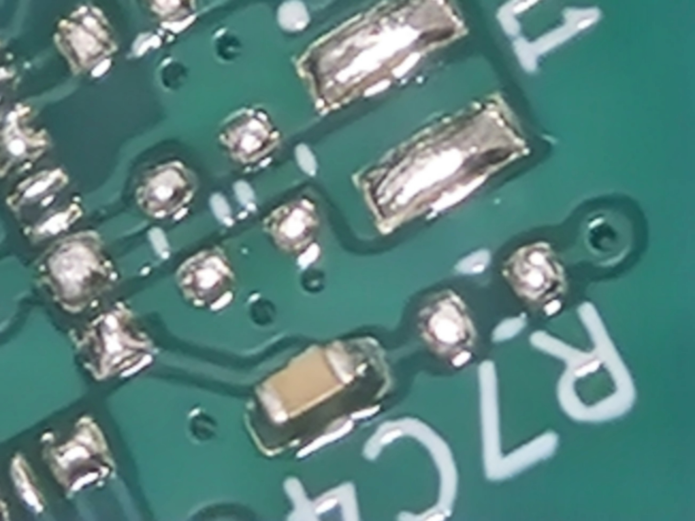
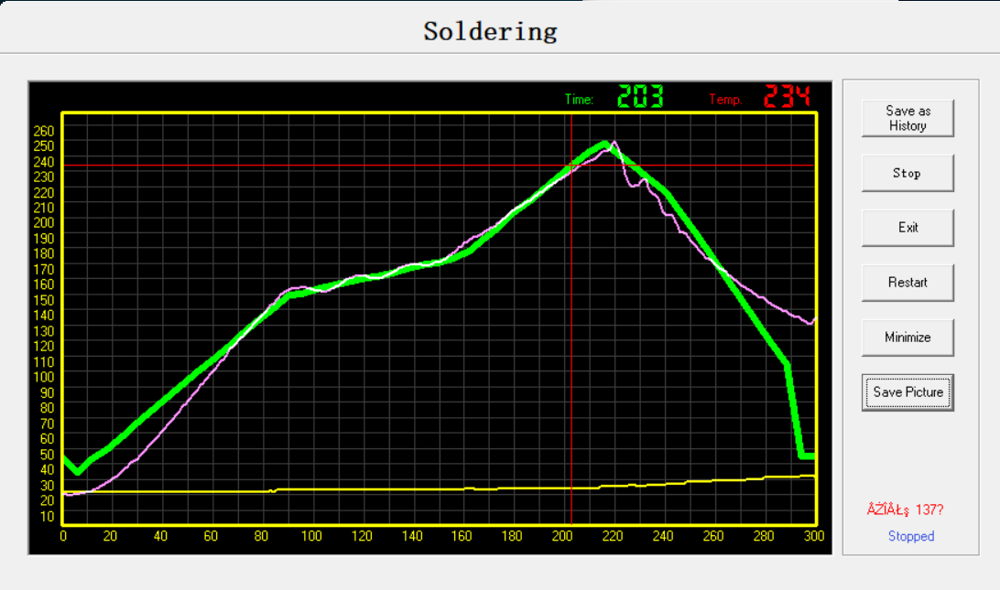

# Osazení desky – pájení přetavením (reflow)

Deska v1.0 osazená 18. 11. 2026 v peci Puhui T-937 (sdílená pec).

## Materiál

| | |
|---|---|
| Pasta | Chip Quik TS391SNL50 – SAC305 (Sn96,5/Ag3/Cu0,5), T4, no-clean, tání 217–220 °C |
| Tavidlo na opravy | Chip Quik SMD291NL |
| Deska | JLCPCB, 4 vrstvy, povrch OSP |
| Šablona | 0,10 mm, apertury 1:1 podle F.Paste |

## Profil (pec T-937, pozice 6)

Body nastavené teploty vzduchu v programu *T937 Reflow Soldering Control System*:

| Čas | 0 s | 90 s | 160 s | 190 s | 215 s | 240 s | 290 s |
|---|---|---|---|---|---|---|---|
| Teplota | 25 °C | 150 °C | 175 °C | 217 °C | 250 °C | 217 °C | 100 °C |

Cíl na desce: prohřátí 150–175 °C ~60–75 s (kratší kvůli T4 a OSP), vrchol 240–245 °C (strop kvůli RM2 a C25),
45–60 s nad 217 °C, deska pecí jen jednou (OSP). Vývodové díly (J4, svorkovnice, lišty, SW1, Keystone) se pájejí ručně.

Uložený recept v programu: `TS391_SAC305`. Pec je sdílená – před každým pečením recept znovu poslat
(`Operation → Send to device → 6`) a zkontrolovat (`View → Profile No.6`).

Vlastní pasta v programu (`Others → User defined solder paste`): Preheat Rate 2, Soak Time 70 (s), Reflow Rate 2,
Cool Rate 3, Soak 150 → 175 °C, liquidus 217 °C, Peak 245 °C, TAL 50 s.

## Zkušební deska

Holá deska s pastou, pár 0402/0603 součástek a pastou na ploškách U1 a RM2, bez podložek, uprostřed šuplíku.
Pájka všude roztavená a zatečená (i na Q3, C25, L1 a termální plošce U1), žádné kuličky ani postavené součástky,
deska ani tavidlo neztmavly. Šedé matné plošky na vrcholu větších nánosů = běžný povrch SAC305 / zbytek tavidla.

## Ostrá deska

Pečeno 19:22–19:27 stejným profilem a na stejném místě. Teplota pece (růžová) sleduje nastavený profil (zelená),
vrchol vzduchu ~250 °C ve ~218 s.

Další kroky: vizuální kontrola a měření podle [OZIVENI.md](../OZIVENI.md).

## Poznámky k programu pece

- Program je Visual Basic 6 – na Windows 11 potřebuje zaregistrovat `MSCOMCTL`, `MSCOMCT2`, `COMCT332`, `COMDLG32`,
  `MSCOMM32`, `MSFLXGRD` (z balíku Microsoft VB6 SP6 KB3096896, rozbalit `msiexec /a`, zkopírovat do `SysWOW64`,
  `regsvr32` jako správce).
- Spouštět z cesty bez čínských znaků (zde `C:\Users\mirac\T937`).
- **Desetinná čísla nezadávat** – při české desetinné čárce program padá (Run-time error 13).
- Pec se hlásí jako `USB-SERIAL CH340`, port se vybírá v `Others → System parameter`, na peci pak F2.
- Tovární profily neodpovídají manuálu (pec je sdílená, profily přepsané).
